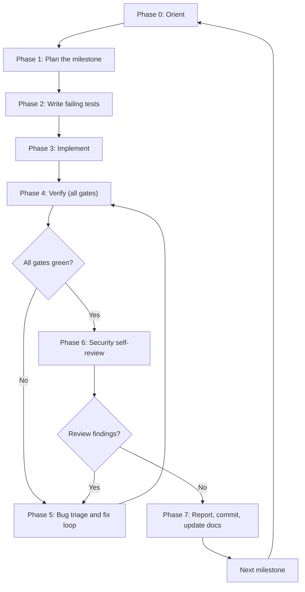
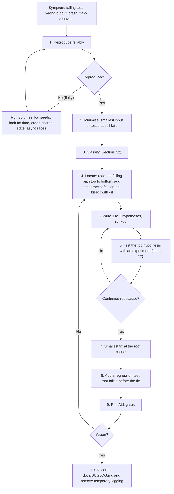

# AI Coding Agent Workflow: Build, Find Bugs, Fix Them

> **Audience:** the AI coding agent in the IDE (Cursor, Windsurf, Claude Code, Copilot agent, etc.).
> **Read first, in this order:** `SYSTEM_DESIGN.md`, `ARCHITECTURE_AND_TECH_STACK.md`, then this file.
> **Prime directive:** this is a security product. A correct, tested, boring solution beats a clever one. When unsure, stop and ask the human.

---

## 0. Standing rules (apply in every phase)

1. Work on **one milestone** (SYSTEM_DESIGN.md Section 11) at a time. Do not touch other packages unless the milestone requires it.
2. **Tests first.** Write the acceptance tests, watch them fail, then implement.
3. **Small diffs.** One concern per commit. Never reformat unrelated files.
4. **Never invent facts.** Do not guess library APIs or versions. Open the installed package's types or README (`node_modules/<pkg>`), or run `npm view`. If still unsure, say so.
5. **Never weaken security to make a test pass.** No disabled signature checks, no skipped tag checks, no hard-coded keys outside test files.
6. **Never log or commit secrets**: private keys, salts, plaintext, nonces, `.env`. Tests use generated keys only.
7. **No new dependency without justification.** State why, check it is maintained, pin the exact version.
8. **Stop and ask** if a task conflicts with the design docs. Propose the change in `docs/DECISIONS.md` instead of silently deviating.
9. **Three-attempt rule:** if the same failure survives three different fix attempts, stop, write down what you learned, and ask the human.

---

## 1. The phase loop



---

## 2. Phase 0: Orient (no code yet)

**Goal:** know the repo and the task before changing anything.

Checklist:
- [ ] Read the three docs fully. Summarise the milestone goal in 3 lines.
- [ ] `git status` and `git log -5`: is the working tree clean? What was done last?
- [ ] List packages and read each package's `README` and `package.json` scripts.
- [ ] Run the full existing test suite and record the baseline (pass/fail counts). **Do not start on a red baseline without noting it.**
- [ ] Confirm the toolchain: `node -v`, `pnpm -v`, `docker compose ps`.

Output: a short note "Baseline: X tests pass, Y fail (names). Milestone: N. Risks: ...".

---

## 3. Phase 1: Plan

Produce, before coding:

```
MILESTONE <N> PLAN
Files to create/change:  ...
Public interfaces (TS signatures):  ...
Tests to write (from acceptance column):  ...
Dependencies needed (name, why):  ...
Risks / unknowns:  ...
Out of scope:  ...
```

Keep it under one page. If the plan needs a design change, stop and ask.

---

## 4. Phase 2: Failing tests first

- Create `*.test.ts` files that encode every acceptance test of the milestone.
- Run them. They must **fail for the right reason** (missing function, not a typo).
- For `packages/crypto` also add **property tests** (fast-check): round trips, tamper detection, ordering.

---

## 5. Phase 3: Implement

- Make tests pass one at a time, smallest change each.
- Validate every external input with **zod** at the boundary (relay, batcher, IPFS, IndexedDB).
- Use constants from `packages/shared` for domain tags. Never retype them.
- Add short comments only where the *why* is not obvious (protocol steps, security reasons).

---

## 6. Phase 4: Verification gates (all must pass)

Run in this order and paste the summary of each:

| Gate | Command (adapt to scripts that exist) | Pass condition |
|---|---|---|
| 1. Types | `pnpm -r typecheck` | 0 errors |
| 2. Lint | `pnpm -r lint` | 0 errors |
| 3. Unit tests | `pnpm -r test` | all green |
| 4. Contracts | `pnpm --filter contracts test` | all green, gas report printed |
| 5. Integration | `docker compose up -d` then `pnpm test:integration` | all green |
| 6. E2E (from Milestone 6) | `pnpm test:e2e` | all green |
| 7. Secret scan | `git diff --staged` + search for `PRIVATE`, `secret`, `.env` | nothing sensitive |

A milestone is **not done** until every applicable gate is green.

---

## 7. Phase 5: Bug triage and fix loop



### 7.1 Rules for debugging

- **Fix the cause, not the symptom.** No `try/catch` that swallows errors, no `setTimeout` to hide a race, no loosening an assertion.
- **Change one thing at a time** between experiments.
- **Never edit a test to match a wrong result.** Edit a test only if the test itself encodes a wrong requirement, and say so explicitly.
- **Remove temporary logging** before committing. Never log secrets while debugging; log lengths, hashes or the first 4 bytes in hex.
- **Do not "fix" by upgrading or adding dependencies** unless the bug is proven to be in that dependency.

### 7.2 Severity and class

| Severity | Meaning | Action |
|---|---|---|
| S1 Critical | Breaks confidentiality, authenticity, or key safety (e.g. plaintext leak, signature not checked) | Stop all other work, fix now, add regression test, flag to human |
| S2 High | Wrong results or data loss (e.g. messages dropped, wrong proof accepted) | Fix before milestone closes |
| S3 Medium | Wrong behaviour in edge cases, poor errors | Fix this milestone if cheap, else log |
| S4 Low | Cosmetic, docs | Log |

Classes: `crypto`, `encoding`, `protocol-state`, `async/race`, `storage`, `network`, `contract`, `config/env`, `ui`, `test-only`.

### 7.3 Bug report template (write this before fixing)

```
BUG-<id>  [S1-S4]  [class]
Symptom:        what was observed (exact error / failing test name)
Expected:       what should happen (cite SYSTEM_DESIGN section)
Repro:          minimal command or test
Root cause:     file:line and why
Fix:            what changed (1-3 lines)
Regression test: file::test name
Gates run:      list, all green
```

Append every bug to `docs/BUGLOG.md` in this format.

### 7.4 Debug toolbox

| Need | Tool |
|---|---|
| Run one test | `pnpm vitest run path/to/file.test.ts -t "name"` |
| Repeat to catch flakiness | `for i in $(seq 1 20); do pnpm vitest run <file> || break; done` |
| Find when it broke | `git bisect start; git bisect bad; git bisect good <sha>` |
| Contract traces | `npx hardhat test --trace` or `console.log` from `hardhat/console.sol` (remove after) |
| Chain state | `npx hardhat console --network localhost` |
| IPFS check | `curl -X POST "http://localhost:5001/api/v0/cat?arg=<cid>"` (from the Docker network only) |
| Relay DB | `sqlite3 relay.db ".tables"`, then inspect rows (never share contents) |
| WebSocket | `npx wscat -c ws://localhost:4000/ws` |
| Browser storage | DevTools, Application, IndexedDB |
| Bytes in hex | `Buffer.from(x).toString("hex").slice(0,8)` (first 4 bytes only) |

---

## 8. Known-pitfall catalogue (check these first when something fails)

### Crypto and encoding

| # | Pitfall | Symptom | Check |
|---|---|---|---|
| C1 | `sodium.ready` not awaited | `undefined is not a function` | Await once at app/test start |
| C2 | base64 vs base64url mixed | Signature or decrypt fails only for some inputs | Use one helper in `shared`; test with bytes containing `+`, `/`, `-`, `_` |
| C3 | JSON key order differs | `bundleHash` or AEAD associated data mismatch | Use one canonical JSON function (sorted keys, no whitespace) |
| C4 | `uint64be(seq)` endianness or JS number overflow | Signature valid locally, invalid elsewhere | Use `BigInt` and `DataView.setBigUint64(..., false)` |
| C5 | Nonce reuse with same key | Catastrophic for ChaCha20-Poly1305 | Fresh random 12-byte nonce per message; keys are per-message anyway; add a test that two encryptions differ |
| C6 | Ed25519 to X25519 conversion applied to the wrong key type | DH results differ between parties | Unit test: both sides derive the same shared secret |
| C7 | Ratchet state advanced before AEAD verified | One forged message desynchronises the session | Work on a copy; commit state only after successful decrypt |
| C8 | Unbounded skipped-message keys | Memory DoS | Cap (e.g. 1000), drop oldest, test the cap |
| C9 | Tag strings retyped by hand | Silent signature mismatch | Import from `shared/constants` |
| C10 | Using `Math.random` | Predictable salts or keys | Only `sodium.randombytes_buf` |
| C11 | Timing-unsafe comparison of secrets | Side channel | `sodium.memcmp` or `crypto.timingSafeEqual` |

### Merkle and ledger

| # | Pitfall | Symptom | Check |
|---|---|---|---|
| M1 | Unsorted pairs vs OpenZeppelin sorted pairs | Off-chain proof valid, `verifyLeaf` false | `merkletreejs` with `sortPairs: true`; cross-test against the contract |
| M2 | Leaf not domain-separated | Second-preimage ambiguity | Leaf = `keccak256("SC1-LEAF" ++ C ++ keccak256(sig))` |
| M3 | Hashing leaves twice or not at all | Root mismatch | Pick `hashLeaves: false`, leaves already hashed |
| M4 | Odd leaf count handling | Last leaf unprovable | Test sizes 1, 2, 3, 63, 64, 65 |
| M5 | ethers v6 `bigint` vs number | `TypeError` or silent precision loss | Use `bigint` for chain values, convert at the UI edge |
| M6 | Parallel transactions from one wallet | `nonce too low` | Serialise batcher txs through a queue |
| M7 | Reading `anchoredAt` before confirmation | Proof shows pending forever or wrong time | Wait for receipt, then read the event |
| M8 | Wrong network or contract address in config | Calls revert or hit nothing | Print `chainId` and address at startup |

### Storage, network, async

| # | Pitfall | Symptom | Check |
|---|---|---|---|
| S1 | `await` of crypto or fetch inside a Dexie transaction | `Transaction committed too early` | Do async work outside, write inside |
| S2 | Writing ratchet state non-atomically | Session breaks after refresh | One transaction updates session and message together |
| S3 | CID version mismatch (v0 vs v1) | Local CID differs from gateway CID | Always request CIDv1 (`cid-version=1`) and compare as strings |
| S4 | Chunking/hash settings differ between local CID computation and Kubo | Local CID differs for large blobs | Use same chunker (default 256 KiB) and raw leaves, or restrict blobs to small size and test |
| S5 | WebSocket reconnect delivers duplicates | Same message twice | De-duplicate by `msgId`; ack only after durable write |
| S6 | Relay ack before client persisted | Message lost on crash | Ack after IndexedDB commit |
| S7 | Missing CORS or wrong origin | Browser blocks, curl works | Check preflight, allow only the client origin |
| S8 | Challenge replay or reuse | Auth bypass | Single-use nonce, 30 s expiry, tested |
| S9 | Clock skew on timestamps | REST signature rejected | Allow 60 s window, return server time in the 401 |
| S10 | SQLite concurrent writes | `database is locked` | WAL mode, single writer, short transactions |

### Frontend

| # | Pitfall | Check |
|---|---|---|
| U1 | State in components instead of stores | Messages lost on route change |
| U2 | Showing "Verified" without running Flow F | Only show the result returned by `VerifyService` |
| U3 | Secrets in React state dumped by devtools or error boundaries | Keep keys in the service layer, not in UI state |

---

## 9. Phase 6: Security self-review (before closing a milestone)

Answer each with evidence (file and test), not "yes":

- [ ] Can any server component (relay, batcher, IPFS, chain) read plaintext, a salt, or a private key? Trace the data.
- [ ] Is every signature verified before its data is trusted, and every AEAD tag checked before state changes?
- [ ] Are all domain tags imported from `shared`?
- [ ] Is every external input validated by zod?
- [ ] Do logs contain only non-secret values (lengths, short hex prefixes)?
- [ ] Are rate limits, size caps and expiries enforced and tested?
- [ ] Do error messages avoid leaking internals?
- [ ] Is there a test for the negative path of every security check (tampered, replayed, expired, wrong key)?
- [ ] Does `git diff` contain any secret, `.env`, or large generated file?
- [ ] Did I add a dependency? Is it justified, pinned, maintained?

Any "no" becomes a bug via Section 7.3.

---

## 10. Phase 7: Report, commit, update docs

1. Commit with a clear message: `feat(crypto): X3DH initiator and responder` or `fix(batcher): sort Merkle pairs, add regression test`.
2. Update `docs/BUGLOG.md` and, if design changed, `docs/DECISIONS.md` (date, decision, reason).
3. Write the **milestone report**:

```
MILESTONE <N> REPORT
Done:            what works (with test names)
Gates:           table of the 7 gates, all green
Bugs found/fixed: BUG ids with severity
Deviations:      anything differing from SYSTEM_DESIGN.md and why
Open risks:      known gaps
Metrics:         gas, latency, sizes if relevant
Next:            milestone N+1 prerequisites
```

---

## 11. Prompts to paste into the IDE

### 11.1 Start a milestone

```
Read SYSTEM_DESIGN.md, ARCHITECTURE_AND_TECH_STACK.md and AGENT_WORKFLOW.md.
We are doing Milestone <N> only. Follow Phase 0 to Phase 4: report the baseline,
write the plan, write failing tests from the acceptance column, then implement.
Obey the standing rules in Section 0. Show gate results at the end.
```

### 11.2 Hunt for bugs in existing code

```
Act as a bug hunter for <package or file>. Do not change code yet.
1. Read the code and the related design section.
2. Check it against the pitfall catalogue in AGENT_WORKFLOW.md Section 8.
3. For each suspected bug write a BUG report (Section 7.3 template) with severity and a
   failing test idea. Rank by severity. Do not report style issues.
```

### 11.3 Fix one bug

```
Fix BUG-<id>. Follow Phase 5 strictly: reproduce, minimise, root cause, smallest fix,
regression test that fails before the fix, run all gates, update docs/BUGLOG.md.
Do not refactor unrelated code. If three attempts fail, stop and report what you learned.
```

### 11.4 Security review

```
Run the Phase 6 security self-review on the changes since <commit>.
Answer every checklist item with file and test evidence. List anything you cannot prove.
```

### 11.5 Explain before changing (use when the agent seems lost)

```
Stop coding. Explain in plain language how <flow name> works in the current code,
step by step, with file names. Then list where it differs from SYSTEM_DESIGN.md.
```

---

## 12. Definition of done (per milestone)

- All acceptance tests from SYSTEM_DESIGN.md Section 11 pass.
- All 7 gates green; baseline did not regress.
- Negative-path tests exist for every security check touched.
- No open S1 or S2 bugs.
- `docs/BUGLOG.md`, `docs/DECISIONS.md` and the milestone report are updated.
- Human has reviewed the report and approved moving to the next milestone.

---

## 13. When to stop and ask the human

- A design document is ambiguous or contradicts itself.
- A fix would require weakening a security property.
- A needed library has no clear, maintained option.
- Three fix attempts failed.
- Any S1 bug is found.
- The task would exceed the current milestone's scope.
