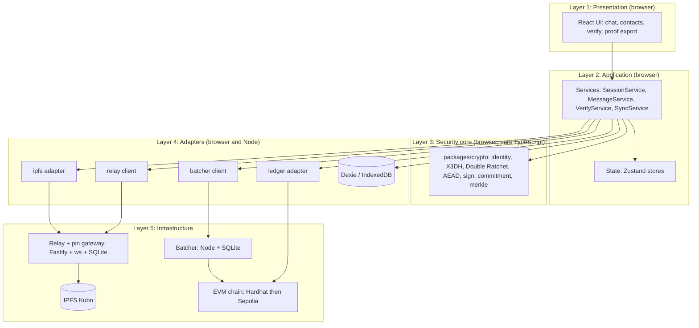
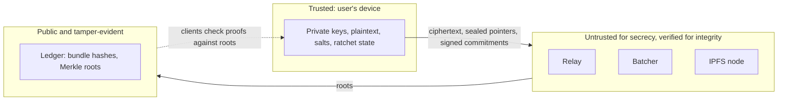

# Architecture and Technology Stack

> Companion to `SYSTEM_DESIGN.md` (flows, schemas, contracts). This file answers: **what are the parts, how are they layered, and which exact technologies and libraries do we use.**
> **Version policy for the IDE agent:** do not invent version numbers. At install time use the current stable release, then pin the exact version in `package.json` (`pnpm add -E <pkg>`). Check each package with `npm view <pkg> version` and read its changelog before upgrading. Skip any release published in the last 14 days.

---

## 1. Architectural style

A **layered, client-heavy architecture with untrusted helpers**:

- All security-critical logic (keys, encryption, signing, verification) runs **in the client**.
- Helper services (relay, batcher, IPFS node) are **untrusted for confidentiality** and **checkable for integrity**.
- The blockchain is a **public notary**: it stores only key-bundle hashes and Merkle roots.

**Dependency rule (agent must enforce):** arrows point downward only. `crypto` imports nothing from the project except `shared`. UI never imports adapters directly; it goes through services.

---

## 2. Trust boundaries

| Component | Sees | Never sees |
|---|---|---|
| Relay | inboxId, ratchet header, sealed pointer, timing, size | plaintext, CID, salt, sender identity (after first contact) |
| Batcher | commitment, signature, senderUserId, convoId, seq | plaintext, CID, salt |
| IPFS | ciphertext blobs, CIDs | keys, plaintext, who reads what |
| Ledger | bundle hashes, Merkle roots, timestamps | anything about individual messages |

---

## 3. Component responsibilities

| Component | Package | Responsibility | State it owns |
|---|---|---|---|
| Client app | `packages/client` | UI, orchestration, local storage, verification | IndexedDB |
| Crypto core | `packages/crypto` | Key generation, X3DH, Double Ratchet, AEAD, signatures, commitments, Merkle | none (pure functions plus ratchet state objects) |
| Shared | `packages/shared` | Types, zod schemas, constants and domain tags | none |
| IPFS adapter | `packages/ipfs` | add/cat with retry, timeout, CID recomputation | none |
| Ledger adapter | `packages/ledger` | Typed contract calls, event decoding, proof checks | none |
| Relay | `packages/relay` | Mailboxes, challenge-response auth, pin gateway, rate limits | SQLite |
| Batcher | `packages/batcher` | Validate leaves, build trees, anchor roots, serve proofs | SQLite |
| Contracts | `contracts/` | `KeyRegistry`, `AnchorRegistry` | on-chain |
| Eval harness | `tools/eval` | Load test, metrics CSV, charts | files |

---

## 4. Deployment views

| Stage | Chain | IPFS | Relay and batcher | Client |
|---|---|---|---|---|
| Local dev | Hardhat node (8545) | Kubo in Docker | Docker compose | Vite dev server |
| Demo and report | Ethereum **Sepolia** testnet via an RPC provider | Kubo on a small VM, pinned | Same VM, behind HTTPS reverse proxy (Caddy) | Static build on Netlify/Vercel or same VM |

Secrets (RPC URL, batcher private key) live in `.env` files that are git-ignored. Provide `.env.example` only.

---

## 5. Technology choices by layer

### 5.1 Language and tooling (all packages)

| Tool | Purpose | Why |
|---|---|---|
| **TypeScript** (strict mode) | One language everywhere | Shared types between client, relay, batcher |
| **Node.js** (current LTS) | Runtime for relay, batcher, tests, scripts | Stable, matches browser crypto libs |
| **pnpm** workspaces | Monorepo package manager | Fast, strict dependency isolation |
| **ESLint** + **Prettier** | Lint and format | Consistent agent output |
| **Vitest** | Unit and integration tests | Fast, TypeScript-native, works with Vite |
| **fast-check** | Property-based tests | Finds ratchet and encoding edge cases |
| **Playwright** | End-to-end browser tests | Two browser profiles chatting |
| **Docker** and **docker compose** | Local infrastructure | One-command stack |
| **Husky** + **lint-staged** | Pre-commit checks | Stops broken commits |

### 5.2 Cryptography (`packages/crypto`)

| Library | Used for | Notes |
|---|---|---|
| **libsodium-wrappers** | Ed25519 sign/verify, Ed25519 to X25519 conversion, X25519 DH, ChaCha20-Poly1305 IETF AEAD, Argon2id (passphrase wrapping), secure random | Audited C library compiled to WebAssembly. **Always `await sodium.ready` first.** |
| **@noble/hashes** | HKDF-SHA256, SHA-256, keccak256 | Audited, pure JS, tiny. Use for hashing and KDF. |
| **@noble/curves** | Optional cross-check of X25519/Ed25519 in tests | Use only in tests unless libsodium lacks something |

Rules: no hand-written primitives. The **Double Ratchet state machine and X3DH composition are written in this project** (following the Signal specifications) on top of those primitives. There is no audited browser-ready JavaScript implementation to drop in, so this code gets extra tests and a review step (see `AGENT_WORKFLOW.md`). Never claim it is production-audited.

### 5.3 Storage (client)

| Library | Purpose |
|---|---|
| **Dexie** | Typed wrapper over IndexedDB |
| **zod** | Runtime validation of everything read from IndexedDB, relay, batcher or IPFS |

### 5.4 Decentralised storage (`packages/ipfs`)

| Library / tool | Purpose |
|---|---|
| **Kubo** (go-ipfs) in Docker | The IPFS node that stores and pins blobs |
| **kubo-rpc-client** | Node-side client for Kubo's RPC (used by the relay's pin gateway) |
| **multiformats** + **ipfs-unixfs-importer** (or **helia** with in-memory blockstore) | Compute a CID locally in the browser to verify what the gateway returned |

Browsers talk to the relay's `POST /blob` and `GET /blob/:cid`, never to Kubo's RPC port.

### 5.5 Blockchain (`contracts/`, `packages/ledger`)

| Library / tool | Purpose |
|---|---|
| **Solidity** (0.8.x, pinned in `hardhat.config.ts`) | Smart contracts |
| **Hardhat** + Hardhat Toolbox | Compile, test, deploy, local chain |
| **@openzeppelin/contracts** | `MerkleProof` for on-chain `verifyLeaf` |
| **ethers** (v6) | Contract calls from client and batcher. Note: v6 uses `bigint`, not BigNumber |
| **merkletreejs** | Build trees off-chain: keccak256, `sortPairs: true`, leaves already hashed. Must match OpenZeppelin `MerkleProof` |
| **hardhat-gas-reporter** | Gas numbers for the report |
| **Sepolia** testnet + faucet | Public demo network |

### 5.6 Relay and batcher services

| Library | Purpose |
|---|---|
| **Fastify** | HTTP server (fast, schema-first) |
| **ws** | WebSocket server for message push |
| **better-sqlite3** | Embedded database (mailboxes, queue, proofs) |
| **@fastify/rate-limit** | Per-IP rate limits |
| **@fastify/helmet**, **@fastify/cors** | Security headers and strict CORS |
| **pino** | Structured logs (with redaction rules, no secrets) |
| **dotenv** | Config |

### 5.7 Client application

| Library | Purpose |
|---|---|
| **React** | UI |
| **Vite** | Build and dev server |
| **Zustand** | Small state stores |
| **React Router** | Navigation |
| **Tailwind CSS** | Styling |
| **qrcode** (or `qrcode.react`) | Show/scan userId QR |

### 5.8 Evaluation and docs

| Tool | Purpose |
|---|---|
| **tools/eval scripts (TypeScript)** | Send N messages, record latency and gas |
| **Python + Matplotlib** (optional) | Charts for the report |
| **Mermaid** | Diagrams in docs |

---

## 6. Interfaces between components (summary)

| From | To | Protocol | Payload |
|---|---|---|---|
| Client | Relay | WebSocket + REST over HTTPS | `RelayEnvelope`, challenge-response auth |
| Client | Relay pin gateway | HTTPS | `BlobEnvelope` bytes, returns CID |
| Client | Batcher | HTTPS JSON | `{commitment, sig, senderUserId, convoId, seq}` |
| Client | Ledger | JSON-RPC (ethers) | `KeyRegistry.publish`, reads of `AnchorRegistry` |
| Batcher | Ledger | JSON-RPC (ethers) | `AnchorRegistry.anchor(root, count)` |
| Relay | Kubo | HTTP RPC (internal network) | `add`, `pin`, `cat` |

Full schemas are in `SYSTEM_DESIGN.md` Section 10.

---

## 7. Why these choices (for the viva)

| Decision | Alternatives considered | Reason |
|---|---|---|
| E2EE with X3DH and Double Ratchet | Plain TLS, PGP | Forward secrecy and post-compromise security, same as Signal |
| Ed25519 for identity and signing | RSA, ECDSA | Fast, small, deterministic, conversion to X25519 available |
| IPFS for blobs | Store on chain, S3 | Content addressing gives integrity for free; chain storage is far too costly |
| Merkle batching | One transaction per message | Cost per message falls roughly as 1 / batch size |
| EVM chain (testnet) | Hyperledger Fabric, custom chain | Mature tooling, free test ETH, public verifiability |
| Untrusted relay | Own central server | Keeps confidentiality independent of operator |
| No JWT or accounts | OAuth, password login | Identity is the key; nothing central to compromise |
| TypeScript everywhere | Mixed languages | Shared types, fewer integration bugs |

---

## 8. Known limitations of the stack (state honestly in the report)

- Ledger confirmation takes seconds to minutes; proofs are asynchronous.
- IPFS availability depends on pinning; we run our own pinning node.
- Relay still sees timing and message size.
- Ratchet and X3DH are custom compositions of audited primitives, not an audited library.
- Browser key storage relies on passphrase wrapping (Argon2id) inside IndexedDB; a compromised device defeats it.
