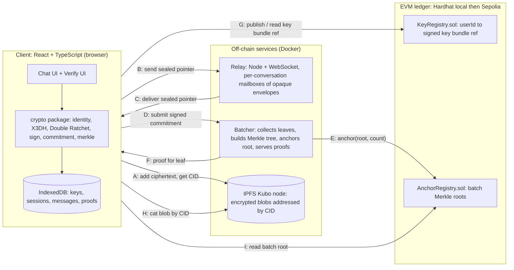
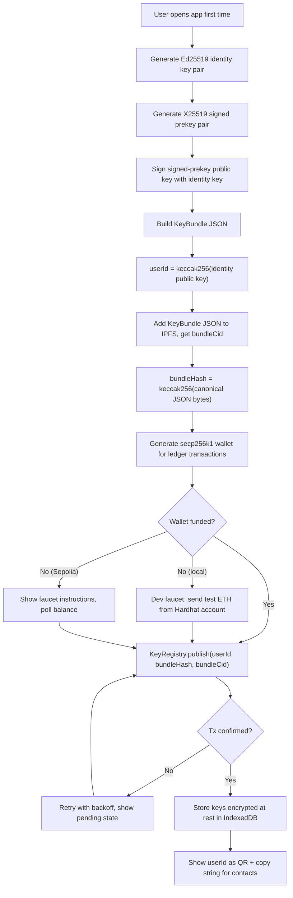
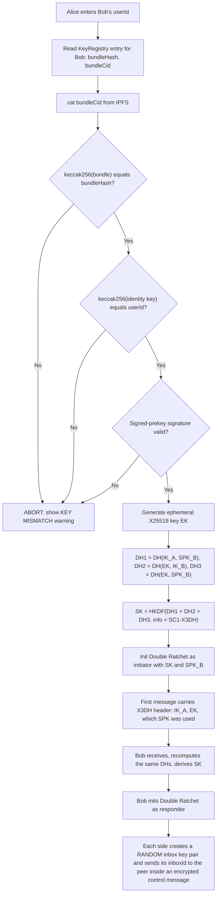
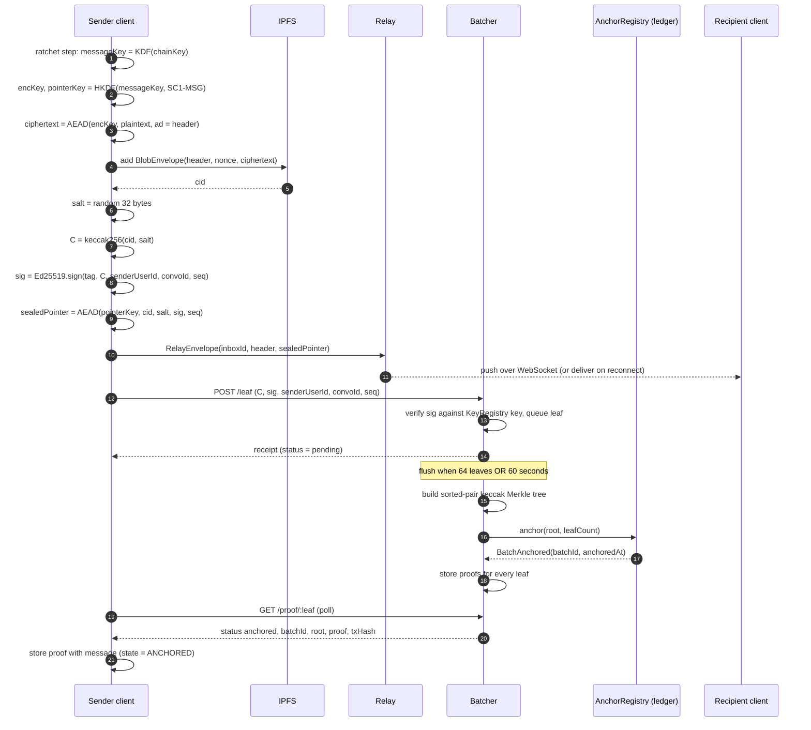
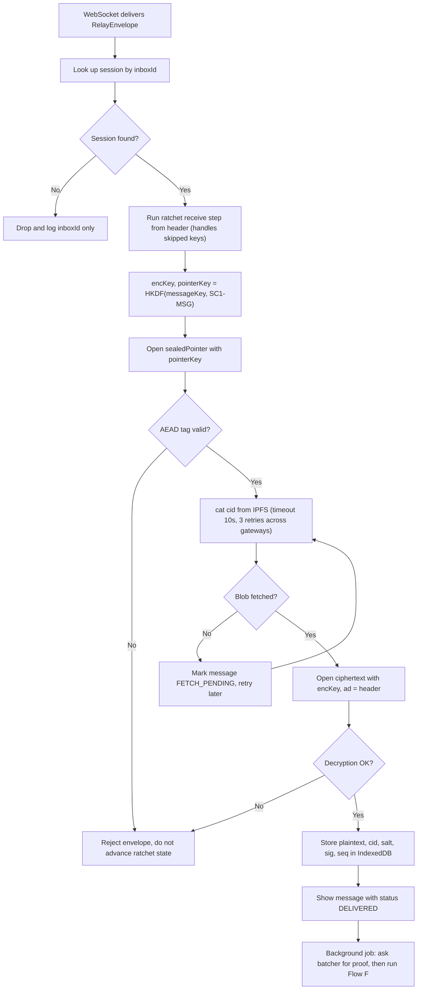
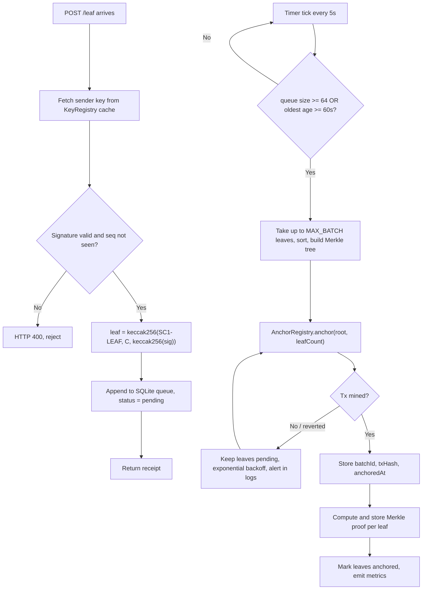
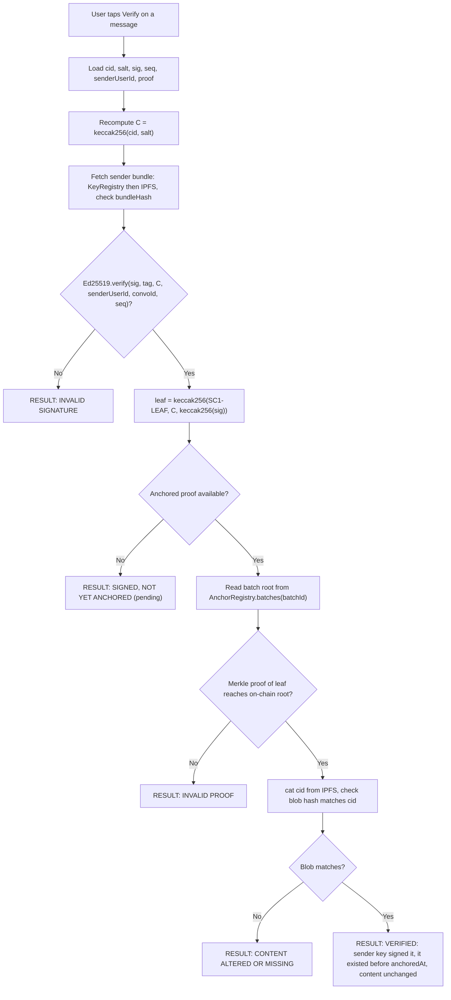
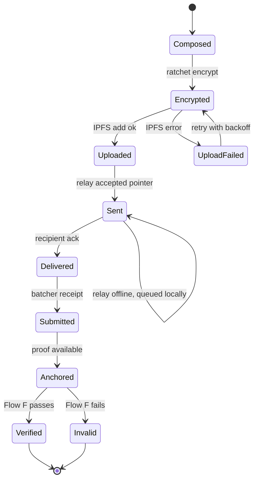
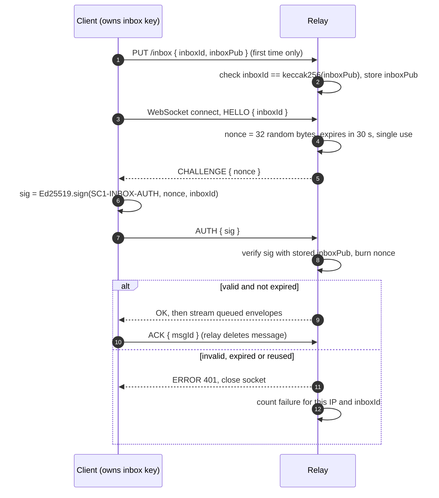

# Verifiable Private Messaging: Complete System Design

> **For the AI coding IDE:** read this whole file before writing code. It is the single source of truth.
> Build in the order of Section 11 (milestones). Do not skip the acceptance tests. Obey the ground rules in Section 1.
> Diagrams are Mermaid: they render in VS Code (Markdown Preview Mermaid Support extension), GitHub, and https://mermaid.live

---

## 1. Ground rules (never break these)

1. **Never write crypto primitives.** Use `libsodium-wrappers` only (X25519, Ed25519, ChaCha20-Poly1305 IETF, HKDF via `crypto_kdf` or `@noble/hashes/hkdf`).
2. **One identity key**: an Ed25519 key pair. Convert to X25519 for Diffie-Hellman with `crypto_sign_ed25519_pk_to_curve25519` and `crypto_sign_ed25519_sk_to_curve25519`.
3. **Plaintext and private keys never leave the client.** Never log keys, salts, plaintext or decrypted pointers. Relay, batcher, IPFS and ledger only ever see ciphertext, salted commitments and public keys.
4. **Ledger holds no personal data**: only key-bundle hashes and Merkle roots.
5. **Hash function on-chain side**: `keccak256` (EVM native, compatible with OpenZeppelin `MerkleProof`). Merkle tree uses **sorted pairs**.
6. **Domain-separate every signature and KDF** with the tags in Section 6.
7. **Verifiable mode is opt-in per conversation** (signing removes deniability). Default = off in UI copy, but the demo enables it.
8. Prototype network: **Hardhat local chain first, Ethereum Sepolia second**. Never mainnet.
9. Every module has unit tests before it is wired to another module.
10. **No accounts, no passwords, no JWT.** Identity is the Ed25519 key. Access to a relay mailbox is proven by signing a server challenge (Section 14).
11. **Browsers never call the Kubo RPC (port 5001) directly.** Use the relay's pin gateway (`POST /blob`, `GET /blob/:cid`).

---

## 2. System overview (components and who talks to whom)



**Trust summary:** the relay and batcher are *untrusted for confidentiality* (they see only opaque data) and *verifiable for integrity* (clients check everything against the ledger). A malicious batcher can delay or omit a leaf, never forge one. The sender can self-anchor as a fallback.

---

## 3. Flow A: Registration and key publishing



**Prototype simplification:** no one-time prekeys (X3DH without OPK is valid but weaker against replay). Add them later as a stretch goal.

---

## 4. Flow B: Session setup (X3DH) and first message



Bob's first-contact inbox is `inbox0 = keccak256("SC1-FIRST" + Bob userId)`. It can be read only by proving possession of Bob's identity key (Section 14), so the relay can link it to Bob by design. After the first exchange each side creates a **random** inbox key pair (`inboxId = keccak256(inboxPub)`) and sends its `inboxId` to the peer in an encrypted control message; all later messages use these unlinkable inboxes. Inbox keys are random, not derived from the shared secret, because a derived key would let the peer read or drain your mailbox.

---

## 5. Flow C: Send a message (end-to-end sequence)



---

## 6. Flow D: Receive and decrypt



### Domain-separation tags (use exactly these strings)

| Purpose | Tag |
|---|---|
| X3DH key derivation | `SC1-X3DH` |
| Message key split | `SC1-MSG` |
| Inbox read authentication | `SC1-INBOX-AUTH` |
| Merkle leaf domain separation | `SC1-LEAF` |
| Signature message prefix | `SC1-SIG` |
| First-contact inbox | `SC1-FIRST` |

---

## 7. Flow E: Batcher (Merkle anchoring)



**Batcher HTTP API**

| Method | Path | Body / Response |
|---|---|---|
| POST | `/leaf` | `{ commitment, sig, senderUserId, convoId, seq }` returns `{ leaf, status: "pending" }` |
| GET | `/proof/:leaf` | `{ status: "pending" }` or `{ status: "anchored", batchId, root, proof: string[], txHash, anchoredAt }` |
| GET | `/health` | `{ queue, lastAnchorAt }` |

---

## 8. Flow F: Verification (the core proof)



**Auditor mode:** the recipient can export a *proof package* `{cid, salt, sig, seq, senderUserId, convoId, batchId, proof, root, txHash}` as JSON. A third party runs the same Flow F without any account. The package reveals the salt for that one message only; the plaintext stays private unless the user also shares the decryption key or the text.

---

## 9. Message lifecycle (state machine for the client)



---

## 10. Data models, contracts and repo layout

### 10.1 TypeScript types (`packages/shared/src/types.ts`)

```ts
export type B64 = string;   // base64url
export type Hex = string;   // 0x-prefixed

export interface KeyBundle {
  v: 1;
  userId: Hex;                    // keccak256(identityKeyEd25519)
  identityKeyEd25519: B64;
  signedPrekeyX25519: B64;
  signedPrekeySig: B64;           // Ed25519 over ("SC1-SPK" + signedPrekeyX25519)
  createdAt: number;              // unix ms
}

export interface RatchetHeader { dh: B64; pn: number; n: number; }

export interface BlobEnvelope {   // this is what goes to IPFS (JSON)
  v: 1;
  header: RatchetHeader;
  nonce: B64;                     // 12 bytes for ChaCha20-Poly1305 IETF
  ciphertext: B64;                // AEAD, associated data = canonical(header)
}

export interface PointerPayload { // sealed with pointerKey, never public
  cid: string;
  salt: B64;                      // 32 random bytes
  sig: B64;                       // Ed25519
  seq: number;                    // per-conversation counter
  ts: number;
}

export interface RelayEnvelope {
  inboxId: Hex;
  header: RatchetHeader;
  nonce: B64;
  sealedPointer: B64;
  x3dh?: { ikA: B64; ek: B64; spkUsed: B64 };  // only on first message
}

export interface ProofPackage {
  cid: string; salt: B64; sig: B64; seq: number;
  senderUserId: Hex; convoId: Hex;
  batchId: number; proof: Hex[]; root: Hex; txHash: Hex;
}
```

**Commitment and leaf**

```
C    = keccak256( utf8(cid) ++ salt )
msg  = utf8("SC1-SIG") ++ C ++ senderUserId ++ convoId ++ uint64be(seq)
sig  = Ed25519.sign(msg)
leaf = keccak256( utf8("SC1-LEAF") ++ C ++ keccak256(sig) )   // tag makes leaf preimage 72 bytes, never equal to a 64-byte inner node
```

`convoId = keccak256(sorted(userIdA, userIdB))`.

### 10.2 Smart contracts (Solidity ^0.8.24, Hardhat, OpenZeppelin)

```solidity
// contracts/KeyRegistry.sol
contract KeyRegistry {
    struct Entry { address owner; bytes32 bundleHash; string bundleCid; uint64 version; uint64 updatedAt; }
    mapping(bytes32 => Entry) public entries;           // userId => entry
    event BundlePublished(bytes32 indexed userId, uint64 version, bytes32 bundleHash, string bundleCid);

    // First caller for a userId becomes owner; later calls must come from owner. version++ each time.
    function publish(bytes32 userId, bytes32 bundleHash, string calldata bundleCid) external;
}

// contracts/AnchorRegistry.sol
contract AnchorRegistry {
    struct Batch { bytes32 root; uint32 leafCount; address submitter; uint64 anchoredAt; }
    Batch[] public batches;
    event BatchAnchored(uint256 indexed batchId, bytes32 root, uint32 leafCount, address submitter);

    function anchor(bytes32 root, uint32 leafCount) external returns (uint256 batchId);
    function verifyLeaf(uint256 batchId, bytes32 leaf, bytes32[] calldata proof) external view returns (bool); // OZ MerkleProof.verify
}
```

Note on squatting: anyone who knows a public key could register its `userId` first. This is acceptable because clients **always** check that the bundle's identity key hashes to `userId` and that the bundle signature is valid, so a squatter cannot substitute keys (worst case is denial of service). Document this in the report.

### 10.3 Repo layout (pnpm monorepo)

```
secure-chat/
  docs/SYSTEM_DESIGN.md            <- this file
  docker-compose.yml               <- kubo, hardhat node, relay, batcher
  contracts/
    KeyRegistry.sol  AnchorRegistry.sol
    test/*.ts  scripts/deploy.ts  hardhat.config.ts
  packages/
    shared/    types.ts, zod schemas, constants (tags)
    crypto/    identity.ts x3dh.ts ratchet.ts aead.ts kdf.ts sign.ts commitment.ts merkle.ts  (+ *.test.ts)
    ipfs/      ipfsClient.ts      (add, cat, retry, timeout)
    ledger/    ledgerClient.ts    (ethers wrappers, ABI, event decoding)
    relay/     server.ts          (ws + REST, SQLite mailbox, TTL 7 days)
    batcher/   server.ts queue.ts tree.ts anchor.ts (SQLite)
    client/    React app: pages/ stores/ services/ components/ (IndexedDB via Dexie)
```

### 10.4 Client stores (Dexie / IndexedDB)

| Table | Key | Fields |
|---|---|---|
| `identity` | `id=1` | encrypted Ed25519 secret, signed prekey secret, wallet key (all wrapped with a passphrase-derived key via Argon2id from libsodium) |
| `contacts` | `userId` | alias, bundle snapshot, bundleHash, firstSeen |
| `sessions` | `convoId` | ratchet state (root key, chain keys, DH keys, counters, skipped keys), inboxId, verifiableMode |
| `messages` | `[convoId, seq]` | direction, plaintext, cid, salt, sig, status, proof (optional), timestamps |

### 10.5 Local dev stack (`docker-compose.yml`)

| Service | Image / command | Port |
|---|---|---|
| IPFS | `ipfs/kubo` | 5001 (RPC), 8080 (gateway) |
| Chain | `npx hardhat node` | 8545 |
| Relay | `packages/relay` | 4000 |
| Batcher | `packages/batcher` | 4100 |
| Client | `pnpm --filter client dev` | 5173 |

---

## 11. Build order (milestones with acceptance tests)

Give the IDE **one milestone at a time**. Do not move on until the acceptance tests pass.

| # | Milestone | Acceptance tests |
|---|---|---|
| 0 | Scaffold monorepo, TS config, lint, docker-compose, shared types | `pnpm build` passes, containers start |
| 1 | `crypto` package | Ed25519 to X25519 conversion works; X3DH: both sides derive same SK; Double Ratchet: 1000 messages in order, out-of-order within window, skipped keys, tampered ciphertext rejected; commitment and Merkle: proof verifies, tampered leaf fails |
| 2 | Contracts | Publish/update only by owner; version increments; anchor stores root; `verifyLeaf` true for valid proof, false otherwise; gas report printed |
| 3 | `ipfs` + `ledger` adapters | add then cat returns same bytes; CID matches local hash; read/write contract from script |
| 4 | Relay + pin gateway | Offline delivery on reconnect; TTL cleanup; rejects oversized envelopes; stores nothing but opaque bytes; **auth tests from Section 14** (wrong key, replayed challenge, expired challenge, rate limit); `POST /blob` returns the CID and client re-computes it locally |
| 5 | Batcher | Rejects bad signature and replayed seq; flush at 64 leaves or 60s; proofs verify against on-chain root; survives restart (SQLite) |
| 6 | Client: registration, contacts, send/receive | Two browser profiles chat end-to-end on local stack; refresh keeps session |
| 7 | Client: verify screen and proof export | All six Flow F outcomes reachable in tests (invalid sig, pending, invalid proof, altered content, verified); auditor CLI verifies an exported package with no account |
| 8 | Evaluation harness | Script sends N messages, writes `metrics.csv` (see 12) |
| 9 | Sepolia deploy and report screenshots | Same tests pass against Sepolia |

### Prompt template to paste into the IDE for each milestone

```
Read docs/SYSTEM_DESIGN.md fully. Implement Milestone <N> only.
Follow the ground rules in Section 1 and the types in Section 10.
Write the tests listed in the acceptance column first, then the code.
Do not change other packages. When done, run the tests and show the output.
```

---

## 12. Evaluation metrics (for the project report)

| Metric | How to measure | Where to hook |
|---|---|---|
| Gas per anchor | Hardhat gas reporter / receipt `gasUsed` | batcher `anchor.ts` |
| **Cost per message** | `gasUsed * gasPrice / leafCount` for batch sizes 1, 16, 64, 256 | batcher |
| Send latency | time from tap to relay ack | client |
| Anchor latency | `Submitted` to `Anchored` time | client state machine |
| Verify time | Flow F start to result | client |
| IPFS fetch time | `cat` duration, p50 and p95 | ipfs adapter |
| Overhead | ciphertext size vs plaintext size | crypto |

Expected finding to demonstrate: **cost per message falls roughly as 1/batch size**, while one-transaction-per-message stays constant.

---

## 13. Threat model cheat sheet

| Threat | Mitigation in this design |
|---|---|
| Relay reads messages | Content is AEAD ciphertext; pointer sealed under a separate key |
| Relay links users | Per-conversation `inboxId` derived from shared secret |
| Server swaps public keys (MITM) | Bundle hash and `userId` anchored in KeyRegistry; client checks hash chain and signature |
| Batcher forges a record | Cannot: needs sender's Ed25519 signature; verifier checks it and the on-chain root |
| Batcher drops a leaf | Sender sees `pending` too long, re-submits or self-anchors |
| Third party links ledger entries to chats | Only salted commitments on-chain; salt stays inside E2EE channel |
| Message altered after send | CID changes, so commitment, signature and proof fail |
| IPFS data disappears | Own pinning node; recipient stores plaintext locally; optional second pin |
| Replay of old envelope | Ratchet counters and per-conversation `seq` uniqueness at batcher |
| Loss of device | Out of scope for prototype (document as limitation) |

---

## 14. Authentication and access control (no JWT, no accounts)

**Principle:** nobody logs in. Possession of a private key proves the right to act. The server never issues long-lived credentials, so there is nothing central to steal or revoke.

| Resource | Who may do what | Proof required |
|---|---|---|
| Relay: post to an inbox | Anyone who knows the `inboxId` | None, but rate-limited and size-capped |
| Relay: read, ack or delete messages in an inbox | Only the inbox owner | Signature over a fresh server challenge with the inbox private key |
| Relay: register an inbox | Anyone | `inboxId == keccak256(inboxPub)` (the ID binds the key) |
| Relay pin gateway: `POST /blob` | Anyone | None, but max 5 MB, rate-limited; content is opaque ciphertext |
| Batcher: `POST /leaf` | Registered users | Ed25519 signature checked against the key in KeyRegistry |
| Batcher: `GET /proof/:leaf` | Anyone | None (a leaf is a salted hash, reveals nothing) |
| KeyRegistry: update a bundle | Contract owner of that `userId` | Ethereum transaction signature |
| Kubo RPC (5001), Hardhat RPC (8545) | Internal Docker network only | Not exposed to browsers |



For REST reads (fallback when WebSocket is blocked) sign each request: header `X-Inbox-Sig = Sign(SC1-INBOX-AUTH, method, path, timestamp, bodyHash)` plus `X-Timestamp`; the relay rejects timestamps older than 60 s and remembers recent signatures to stop replays.

**Relay changes for Milestone 4**

1. Tables: `inboxes(inboxId PK, inboxPub, createdAt)`, `messages(msgId PK, inboxId, bytes, receivedAt)`, `challenges(nonce PK, inboxId, expiresAt, used)`.
2. Endpoints: `PUT /inbox`, `POST /inbox/:id/messages`, `GET /ws`, `POST /blob`, `GET /blob/:cid`.
3. Limits (configurable): envelope 64 KB, blob 5 MB, 1000 pending messages per inbox, 60 requests/min per IP, 5 failed auths/min per IP, message TTL 7 days.
4. The first-contact inbox (`SC1-FIRST`) authenticates with the identity key instead of an inbox key; the relay can link it to that user by design (documented trade-off).
5. Never log nonces, signatures, inbox public keys or envelope contents; log `inboxId` prefix (first 8 hex chars) only.
6. Pin gateway: after `ipfs add`, return the CID; the client recomputes the CID locally and aborts on mismatch.

**If an examiner insists on tokens:** after a successful challenge the relay may issue a 15-minute JWT bound to that `inboxId` (HS256, server secret in env, claim `sub = inboxId`) purely as a session convenience. It is optional and never identity.

---

## 15. Explicit non-goals

Group chat, voice/video, mainnet, one-time prekeys, device sync, push notifications, key recovery. List them under "Future scope" in the report.
